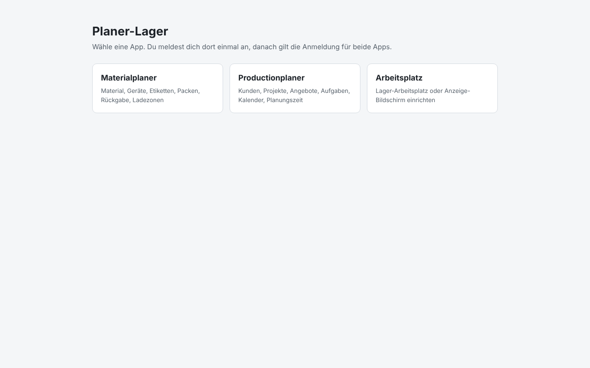

# Planer-Lager-Core

Lager-Server, Fachlogik und gemeinsame Oberfläche für **Materialplaner** und **Productionplaner**: Material, Lager und Projekte eines Verleih- und Eventtechnik-Betriebs in einem System. Teil der Planer-Familie (Stromplaner, Netzwerkplaner).

Ein zentraler Server (Node 22, PostgreSQL 16, Docker + Caddy/HTTPS). Beide Apps sind Clients, als Desktop-App (Windows, macOS) **und** im Browser. Arbeitsplätze im Lager laufen im Browser, Handscanner tippen wie eine Tastatur, Netzwerk-Scanner melden sich über TCP/HTTP am Server.

> **Beta.** Installer der Apps unter [Materialplaner › Releases](https://github.com/Nomisimo/Materialplaner/releases) und [Productionplaner › Releases](https://github.com/Nomisimo/Productionplaner/releases). Beide Apps tragen immer dieselbe Versionsnummer.



## Funktionen

| Bereich | Inhalt |
|---|---|
| **Materialplaner** | Material und Geräte mit Codes, Etiketten (Designer, Druck, Bestellung), Kabel, Scannen/Packen/Rückgabe, Verladen, Prüfstatus, Ladezonen, Arbeitsplätze, Inventur, Reparatur, Lagerorte, Schadensdoku, Plan-Symbole (yEd) |
| **Productionplaner** | Kunden, Projekte und Jobs, Aufgaben, Dateien, Kalender, Angebote mit Verfügbarkeit, Preisen, Fassungen und PDF, Planungszeit, Personal, Fahrzeuge, Projektvorlagen, Kalkulator |
| **Zusammenspiel** | Ein Konto, eine Anmeldung für beide Apps (Handoff), Live-Updates ohne Neuladen (WebSocket), Deep-Links zwischen den Apps, globales Codefeld, gleiche Kopfleiste, gleichzeitiges Arbeiten mit Konfliktanzeige („Das hat gerade … geändert“), Präsenz-Anzeige |
| **Arbeitsplatz-Web** | `https://<server>/station`: Packplatz oder Rückgabeplatz im Vollbild, Entsperren per PIN, großes farbiges Scan-Ergebnis, sperrt sich selbst |
| **Verwaltung** (Admins) | Benutzer, Rollen und Rechte, Einstellungen, Sicherung und Wiederherstellung, Sicherheits-Check, Zwei-Faktor, Wartung, Arbeitsplätze, Scanner |
| **Hilfe** | Einführungs-Touren je App, Willkommen beim ersten Login, Tastenkürzel, „Was ist neu?“ |
| **Updates** | Die Desktop-Apps zeigen einen Hinweis, wenn auf GitHub eine neuere Version liegt; die Browser-Version kommt immer mit dem Server |

## Betrieb

Server einrichten, Sicherungen, Sicherheit und Wartung: [deploy/BETRIEB.md](deploy/BETRIEB.md). Kurzfassung:

```sh
cd deploy
cp .env.beispiel .env      # DOMAIN, Passwörter, BACKUP_SCHLUESSEL eintragen
docker compose up -d --build
```

Danach `https://<DOMAIN>/health` prüfen und in den Apps die Server-Adresse `https://<DOMAIN>` eintragen (Anmeldeseite).

**Testserver:** Ein echter Testserver mit Beispieldaten läuft bei Oracle Cloud (Always Free, 0 €) und wird nur über GitHub Actions verwaltet: Anlegen, Image (ARM + AMD), Bespielen, Prüfen, Wartung, Zurücksetzen. Details: [deploy/BETRIEB.md › Testserver](deploy/BETRIEB.md#testserver-oracle-always-free). Tests dagegen: `LAGER_REMOTE_URL=https://<TEST_DOMAIN> npm run e2e:remote`.

Kommandozeile im Server-Container: `npm run lager -- sicherung | restore <Datei> | pruefen <Datei> | sicherheitscheck [--absichern] | einmal-zugang <Benutzer>`.

## Entwicklung

Voraussetzungen: Node 22, PostgreSQL 16 (lokal), für E2E-Tests `xvfb-run`. Die Apps liegen als Nachbarordner `../Materialplaner` und `../Productionplaner` (sie binden diesen Core als Submodule `core/` ein).

```bash
npm install
bash scripts/db-test.sh      # PostgreSQL starten und Testdatenbank anlegen
npm test                     # Unit- und API-Tests
npm run lint
npm run e2e                  # Playwright gegen Electron und Browser (baut beide Apps)
npm run spec:abdeckung       # jede Spec-ID hat einen Test
npm run dev:server           # Server auf :8080
npm run seed -- --seed demo  # Beispielbetrieb (in Verwaltung › System löschbar)
npm run screenshots          # Bilder für die READMEs nach docs/screenshots/
```

Der Spec-Stand steht in [PROGRESS.md](PROGRESS.md), Annahmen in [ENTSCHEIDUNGEN.md](ENTSCHEIDUNGEN.md), Testergebnisse und gefundene Fehler in [BERICHT.md](BERICHT.md). Architektur: [docs/ARCHITEKTUR.md](docs/ARCHITEKTUR.md), Designsprache: [docs/UI-STIL.md](docs/UI-STIL.md).

## Ordnerstruktur

```
packages/
  domain/       Fachregeln ohne Datenbank (Codes, Geld in Cent, Verfügbarkeit, Rechte)
  db/           Migrationen (SQL), Zugriff, Fassungen (gleichzeitiges Arbeiten)
  server/       HTTP-API, WebSocket-Hub, Scanner-Gateway, PDF, Sicherung, CLI
  client/       API-Client und Live-Verbindung für alle Oberflächen
  ui/           gemeinsame React-Bausteine, Kopfleiste, Menü, Verwaltung, Touren, Hilfe
  shell/        gemeinsamer Electron-Hauptprozess und Preload
  station-web/  Arbeitsplatz-Oberfläche für den Browser
e2e/            Playwright-Tests (Electron + Browser), Screenshots in e2e/artefakte/
deploy/         docker-compose, Caddy, Betriebsanleitung
docs/           Architektur, UI-Stil, Spec-Index, Screenshots
scripts/        Build der Apps, Tests, Seed, Screenshots
```

## Lizenz

Copyright 2026 Nomisimo (Momo). Lizenziert unter der [Apache License 2.0](LICENSE). Siehe auch [NOTICE](NOTICE).
